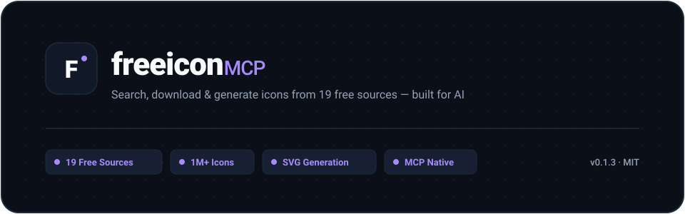

<p align="center">
  <picture>
    <source media="(prefers-color-scheme: dark)" srcset="assets/freeicon-hero-dark.svg">
    <source media="(prefers-color-scheme: light)" srcset="assets/freeicon-hero-light.svg">
    
  </picture>
</p>

# freeicon-mcp — 多源图标/素材聚合服务器

[](https://www.npmjs.com/package/freeicon-mcp)
[](LICENSE)

**[简体中文](#中文) | [English](#english)**

## 中文

**freeicon-mcp** 让 AI 助手（Claude / Cursor / Codex / ChatGPT / Windsurf / Qoder / Kimi Code / MiniMax / ZCode / WorkBuddy / opencode 等主流客户端）通过 MCP 从 **19 个免费素材源**搜索下载图标、插画、照片与艺术品——百万级图标 + 1 亿+ CC 图片，还能**按规范生成自定义 SVG 图标与品牌 Logo**（多个创意方向 + 品牌级校验）、**提取任意网站的图标**（favicon / apple-touch-icon / SVG logo）。

| 我要找… | 做法 |
|---------|------|
| UI 图标 | `i_search_all(keyword)` → `i_download(source, id, color?, size?)` |
| 品牌 logo | `i_download(source="simple-icons", id="github")` |
| 多色插画 | `i_search(keyword, type="illustration")` → `i_download_svg(id)` |
| 照片 / 艺术品 | `i_download(source="openverse" / "artic" / "cma", id)` |
| 网站 favicon / logo | `i_site_icon(url="apple.com")`（自动解析 + 三级兜底）|
| 场景插画配图 | `ia_generate(scene="...", style="flat")` → AI 按专业规范画 480×360 场景卡（14 种风格）|
| 项目 logo / 品牌标识 | `lg_generate(project="freeicon", style="tech")` → N 个创意方向，AI 逐个绘制并校验 |
| 搜不到 → 生成 | `g_generate(description)` → AI 画 → `g_validate(svg)` |

## 功能特性

- 🔍 **跨源融合搜索**：一次关键词命中全部免费源，id 格式统一标注
- 🎨 **矢量优先**：SVG 图标任意改色 / 任意尺寸，结果直接写入项目
- 🖼 **多色插画**：iconfont 插画库原始多色 SVG、博物馆 CC0 高清艺术品
- 🌐 **网站图标提取**：给一个 URL，抓取 favicon / apple-touch-icon / SVG logo（三级兜底，SVG/位图智能交付）
- 🪄 **AI 图标生成**：Lucide 官方设计规范 + 安全校验（拒绝脚本注入等恶意内容）
- 🖌 **场景插画**：14 种专业扁平插画风格（人物/道具/构图/失败模式全规范，源自 mengto/skills MIT）
- 🏷 **品牌 Logo 设计**：2-6 个截然不同的创意方向 + 品牌级校验（自包含/文字回退/小尺寸可辨识）
- 📦 **双渠道发布**：npm + GitHub Packages 镜像（Release 触发自动发布）
- 🔓 **零门槛**：全源免 API key，仅 iconfont.cn 需登录

## 数据来源（19 源 + iconfont）

**仅 iconfont.cn 需要登录（🔐），其余全部免登录免 key。**

| 数据源 | 数量 | 协议 | 登录 |
|--------|:----:|:----:|:----:|
| [Iconify](https://iconify.design)（聚合 150+ 图标集） | 200,000+ | 各集开源 | — |
| [Lucide](https://lucide.dev) / [Tabler](https://tabler-icons.io) / [MDI](https://pictogrammers.com/library/mdi/) / [Heroicons](https://heroicons.com) / [Bootstrap](https://icons.getbootstrap.com) / [Ionicons](https://ionicons.com) / [Octicons](https://primer.style/foundations/icons) / [Remix](https://remixicon.com) / [Iconoir](https://iconoir.com) / [css.gg](https://css.gg) / [Boxicons](https://boxicons.com) | 704–7,447 | MIT 等 | — |
| [Simple Icons](https://simpleicons.org)（品牌 logo） | 3,247 | CC0 | — |
| [Font Awesome Free](https://fontawesome.com) | 2,883 | CC BY 4.0 | — |
| [Icons8](https://icons8.com)（免费档，仅 PNG） | 100,000+ | 需署名 | — |
| [Wikimedia Commons](https://commons.wikimedia.org) | 海量 SVG | 逐图标注 | — |
| [Openverse](https://openverse.org)（CC 图片聚合） | 1 亿+ | 逐图标注 | — |
| [Art Institute of Chicago](https://www.artic.edu) | 62,000+ | CC0 | — |
| [Cleveland Museum of Art](https://www.clevelandart.org/open-access-api) | 30,000+ | CC0 | — |
| **[iconfont.cn](https://www.iconfont.cn)**（图标 + 插画） | 海量 | — | **🔐 需登录** |

完整信息（id 格式、交付格式、署名要求、各源说明）→ [docs/sources.md](docs/sources.md)

## 快速开始

```bash
npm install -g freeicon-mcp
```

接入 MCP 客户端（主流客户端配置入口见 [docs/guide.md](docs/guide.md#二配置接入mcp-客户端)）：
```json
{ "mcpServers": { "freeicon": { "command": "npx", "args": ["-y", "freeicon-mcp"], "type": "stdio" } } }
```

```text
i_guide                                   # AI 先调这个，返回完整使用指南
i_search_all(keyword="home")              # 跨源搜索
i_download(source="tabler", id="home", color="#3B82F6", size=32)
```

opencode 等其它客户端配置 → [docs/guide.md](docs/guide.md#一安装与配置)

## 使用须知

1. **🔐 iconfont.cn 需要登录**：调 `i_login` 弹浏览器登录（cookie 自动保存，约 30 天）；其余 19 源无需任何登录
2. **iconfont 先搜后下**：`i_download_svg` / `i_detail` 必须先用 `i_search` 搜到该 ID
3. **署名义务**：Font Awesome Free 与 Icons8 免费档需署名；Openverse / Commons 逐图协议见搜索结果的 `extra`
4. **光栅源**（Icons8 / Openverse / AIC / CMA）交付 base64 图片（data URI），改色不适用；Openverse 匿名限额 20 次/分，`ov_register(email)` 一键注册后 100 次/分 + 10,000 次/天
5. **插画**（iconfont 插画库）为多色原稿 SVG，下载时不应用改色，可设尺寸

更多细节 → [docs/guide.md](docs/guide.md#四使用须知)

## 文档

| 文档 | 内容 |
|------|------|
| [docs/sources.md](docs/sources.md) | 数据源完整列表：协议、登录、署名、id 格式、交付格式 |
| [docs/tools.md](docs/tools.md) | 32 个工具完整参考与 id 格式速查 |
| [docs/guide.md](docs/guide.md) | 安装配置、iconfont 登录、工作流、使用须知、故障排查 |

## English

**freeicon-mcp** is a [Model Context Protocol](https://modelcontextprotocol.io) server that puts **19 free icon & asset sources** in front of your AI assistant — over a million icons, 100M+ Creative Commons images, and public-domain museum art. Search, recolor, resize, download — extract **any website’s favicon or logo** from its URL — and when nothing fits, **generate a custom SVG icon to spec**.

Works out of the box with Claude, Cursor, Codex, ChatGPT, Windsurf, Qoder, Kimi, MiniMax, ZCode, opencode, and any other MCP-compatible client.

### What you can do

| You want… | Call |
|---|---|
| UI icons | `i_search_all(keyword="home")` → `i_download(source, id, color?, size?)` |
| Brand logos | `i_download(source="simple-icons", id="github")` |
| Full-color illustrations | `i_search(keyword, type="illustration")` → `i_download_svg(id)` |
| Photos & artwork | `i_download(source="openverse" / "artic" / "cma", id)` |
| A website’s favicon / logo | `i_site_icon(url="apple.com")` — page parsing with 3-tier fallback |
| Nothing fits → draw one | `g_generate(description)` → AI sketches it → `g_validate(svg)` |

### Sources

Every source is free and keyless — **only iconfont.cn requires a login** 🔐.

| Source | Assets | License | Login |
|---|---|---|---|
| [Iconify](https://iconify.design) (aggregates 150+ sets) | 200,000+ | per-set OSS | — |
| Lucide, Tabler, MDI, Heroicons, Bootstrap, Ionicons, Octicons, Remix, Iconoir, css.gg, Boxicons | 704–7,447 each | MIT & friends | — |
| [Simple Icons](https://simpleicons.org) (brand logos) | 3,247 | CC0 | — |
| [Font Awesome Free](https://fontawesome.com) | 2,883 | CC BY 4.0 | — |
| [Icons8](https://icons8.com) (free tier, PNG only) | 100,000+ | attribution | — |
| [Wikimedia Commons](https://commons.wikimedia.org) | millions of SVGs | per-file | — |
| [Openverse](https://openverse.org) (CC image aggregator) | 100M+ | per-image | — |
| [Art Institute of Chicago](https://www.artic.edu) · [Cleveland Museum of Art](https://www.clevelandart.org/open-access-api) | 92,000+ | CC0 | — |
| **[iconfont.cn](https://www.iconfont.cn)** (icons + illustrations) | massive | — | **🔐 login** |

Full details: [docs/sources.md](docs/sources.md)

### Quick start

```bash
npm install -g freeicon-mcp
```

Drop it into your MCP config (see [docs/guide.md](docs/guide.md) for per-client paths):

```json
{ "mcpServers": { "freeicon": { "command": "npx", "args": ["-y", "freeicon-mcp"], "type": "stdio" } } }
```

Then from your AI assistant:

```text
i_search_all(keyword="home")      # search every source at once
i_download(source="tabler", id="home", color="#3B82F6", size=32)
```

### Good to know

- **Only iconfont.cn needs a login** (`i_login` opens a browser; cookies last ~30 days). Everything else works instantly.
- **Search before you download** — iconfont downloads are served straight from search results.
- **Attribution**: Font Awesome Free and Icons8's free tier require credit; Openverse and Commons carry per-image licenses in every result.
- **Raster sources** (Icons8, Openverse, AIC, CMA) return base64 data URIs — color overrides don't apply.
- Openverse's anonymous limit is 20 req/min; `ov_register(email)` raises it to 100 req/min in one command.

### Docs

Full documentation lives in [docs/](docs/) (Chinese): [sources](docs/sources.md) · [tools](docs/tools.md) · [guide](docs/guide.md). AI clients can also call `i_guide` for the built-in guide.

---

## License

[MIT](LICENSE)
